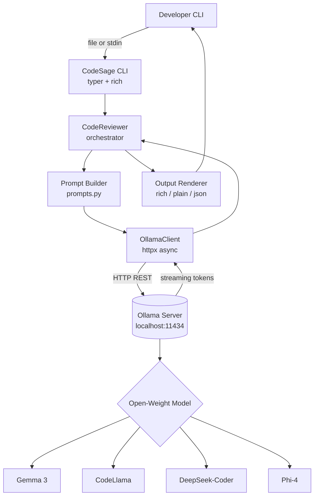

# 🧙 CodeSage — Local AI Code Reviewer

> **Your privacy-first, zero-cloud code review assistant.**  
> CodeSage runs entirely on your machine using open-weight LLMs via [Ollama](https://ollama.com).  
> No API keys. No data sent to third-party servers. 100% offline-capable.

[](https://python.org)
[](LICENSE)
[](https://ollama.com)
[](https://hacktoberfest.com)

---

## ✨ What Does CodeSage Do?

CodeSage is a **command-line tool** that uses locally-running open-weight AI models (Gemma 3, CodeLlama, DeepSeek-Coder, etc.) to give you instant, structured code reviews — directly in your terminal.

**Key capabilities:**

| Command | What it does |
|---------|-------------|
| `codesage review file.py` | Full structured review: bugs, security, performance, style |
| `codesage explain algo.rs` | Plain-English explanation of what code does |
| `codesage fix app.js --issue "Null ref on line 42"` | AI-suggested fix for a specific problem |
| `codesage models` | List all locally available Ollama models |
| `cat code.go \| codesage review --language Go` | Pipe code directly from stdin |

---

## 🏗️ Architecture



### Component Overview

```
code-sage/
├── codesage/
│   ├── __init__.py        # Package metadata & version
│   ├── cli.py             # Typer CLI — all commands live here
│   ├── config.py          # Config loaded from .env
│   ├── logger.py          # Rich-powered logging
│   ├── ollama_client.py   # Async HTTP client for Ollama API
│   ├── prompts.py         # All LLM prompt templates
│   ├── reviewer.py        # Core review orchestration logic
│   └── output.py          # Terminal rendering (rich/plain/json)
├── tests/
│   ├── test_config.py
│   ├── test_prompts.py
│   └── test_reviewer.py   # Mocked — no live Ollama needed
├── .env.example           # Template for environment config
├── .gitignore
├── LICENSE                # MIT
├── pyproject.toml         # PEP 517 build & CLI entrypoint
├── requirements.txt       # Pinned production deps
└── setup.sh               # One-command bootstrap script
```

---

## 🚀 Quick Start

### Prerequisites

| Requirement | Version | Install |
|---|---|---|
| Python | 3.10+ | [python.org](https://python.org) |
| Ollama | latest | [ollama.com](https://ollama.com) |
| A model | any open-weight | `ollama pull gemma3` |

---

### Option A — Automated Setup (recommended)

```bash
# 1. Clone the repository
git clone https://github.com/himankk/code-sage.git
cd code-sage

# 2. Run the setup script (creates venv, installs deps, pulls gemma3)
bash setup.sh

# 3. Activate the virtual environment
source .venv/bin/activate

# 4. Start Ollama (in a separate terminal or as a background service)
ollama serve

# 5. Review your first file!
codesage review codesage/reviewer.py
```

---

### Option B — Manual Setup

```bash
# 1. Clone and enter the project
git clone https://github.com/himankk/code-sage.git
cd code-sage

# 2. Create and activate a virtual environment
python3 -m venv .venv
source .venv/bin/activate          # On Windows: .venv\Scripts\activate

# 3. Install dependencies
pip install -r requirements.txt
pip install -e .                   # Installs the `codesage` CLI command

# 4. Configure environment
cp .env.example .env
# Edit .env to set your preferred model, etc.

# 5. Pull an open-weight model
ollama pull gemma3                 # ~5 GB — runs great on 8 GB RAM
# OR
ollama pull codellama              # optimised for code tasks
# OR
ollama pull deepseek-coder         # excellent for code review

# 6. Start the Ollama server
ollama serve
```

---

## 💻 Usage Examples

### Review a Python file

```bash
codesage review app.py
```

### Review with a security focus

```bash
codesage review auth.py --focus security
```

### Use a different model

```bash
codesage review handler.go --model codellama
```

### Pipe code from stdin

```bash
cat main.rs | codesage review --language Rust
```

### Get a plain-English explanation

```bash
codesage explain complex_algorithm.py
```

### Ask for a fix

```bash
codesage fix payment.py --issue "Potential race condition in balance deduction"
```

### Output as JSON (great for CI pipelines)

```bash
codesage review server.ts --output json > review.json
```

### List available local models

```bash
codesage models
```

---

## 📋 Sample Output

```
╭─────────────────────────────────────────────────────╮
│ 🔍 CodeSage Review                                   │
│ File: auth.py  Language: Python  Model: gemma3       │
╰─────────────────────────────────────────────────────╯

## 🎯 Summary
An authentication handler that validates JWT tokens and returns
user session data. Uses Flask-JWT-Extended for token decoding.

## 🐛 Bugs & Issues
- Line 34: `user_id` is used before the `None` check on line 38.
  This will raise `AttributeError` if `decode_token()` returns None.

## ⚡ Performance
✅ Looks efficient.

## 🔒 Security
- Line 12: JWT secret is hardcoded as `"my-secret-key"`.
  Move this to an environment variable immediately.
- No rate limiting on the `/login` endpoint — brute-force risk.

## 🧹 Code Quality & Style
- Function `validate_user` does too much — split into smaller helpers.
- Variable names `u`, `d`, `t` are too abbreviated.

## 💡 Suggestions
1. Move JWT secret to environment variable: `os.getenv("JWT_SECRET")`
2. Add `@limiter.limit("5/minute")` on the login route.
3. Add type hints to all function signatures.

## ⭐ Overall Score
5/10 — Functional but has a critical security vulnerability and needs refactoring.
```

---

## ⚙️ Configuration

All settings live in `.env`. Copy from `.env.example`:

| Variable | Default | Description |
|---|---|---|
| `OLLAMA_BASE_URL` | `http://localhost:11434` | Ollama server URL |
| `OLLAMA_MODEL` | `gemma3` | Default model |
| `LOG_LEVEL` | `INFO` | Logging verbosity |
| `MAX_TOKENS` | `2048` | Max response length |
| `REQUEST_TIMEOUT` | `120` | HTTP timeout in seconds |
| `OUTPUT_FORMAT` | `rich` | `rich` \| `plain` \| `json` |

---

## 🧪 Running Tests

```bash
# Run all tests (no live Ollama needed — all LLM calls are mocked)
pytest

# With coverage report
pytest --cov=codesage --cov-report=term-missing

# Run a specific test file
pytest tests/test_reviewer.py -v
```

---

## 🤝 Contributing

Contributions are warmly welcomed! This project is part of **Hacktoberfest 2026**.

1. Fork the repository
2. Create a feature branch: `git checkout -b feat/your-feature`
3. Make your changes and add tests
4. Run the test suite: `pytest`
5. Open a Pull Request 🎉

Good first issues:
- Add support for more file types / languages
- Add a `diff` mode to review only changed lines (git diff integration)
- Add a VS Code extension wrapper
- Improve prompt templates for specific languages

---

## 🛠️ Tech Stack

| Component | Technology | Why |
|---|---|---|
| **AI Runtime** | [Ollama](https://ollama.com) | Local inference, zero cloud |
| **AI Models** | Gemma 3, CodeLlama, DeepSeek-Coder | Open-weight, no API key |
| **CLI Framework** | [Typer](https://typer.tiangolo.com) | Beautiful, type-safe CLI |
| **Terminal UI** | [Rich](https://rich.readthedocs.io) | Markdown rendering, colours |
| **HTTP Client** | [HTTPX](https://www.python-httpx.org) | Async, streaming support |
| **Config** | [python-dotenv](https://pypi.org/project/python-dotenv/) | `.env` support |
| **Testing** | [pytest](https://pytest.org) | Clean, expressive tests |

---

## 📄 License

MIT — see [LICENSE](LICENSE).

---

## 🌟 Star this repo if CodeSage saved you time!

Made with ❤️ for Hacktoberfest 2026 — open-source AI that stays on your machine.
